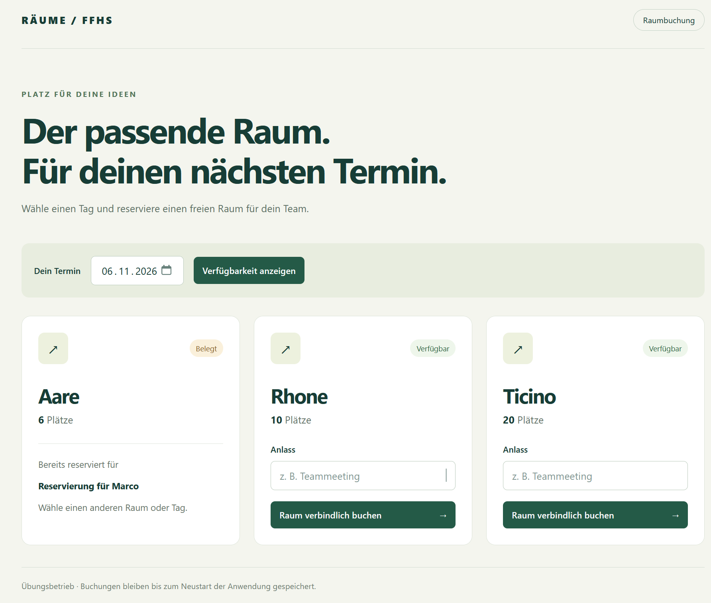
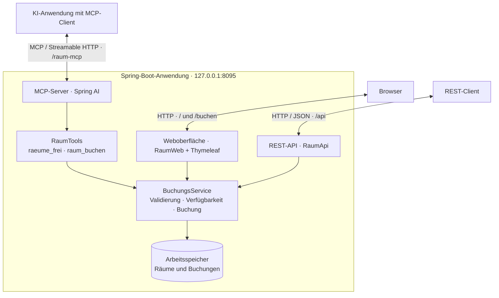

# Räume / FFHS

Kleine Raumbuchungs-App für die FFHS: freie Räume nach Datum anzeigen und direkt für einen Anlass reservieren. Buchungen sind über die Weboberfläche, eine REST-API und einen MCP-Server möglich.



## Funktionen

- Drei Räume: Aare (6 Plätze), Rhone (10 Plätze) und Ticino (20 Plätze).
- Verfügbarkeit prüfen und Doppelbuchungen verhindern.
- MCP-Werkzeuge `raeume_frei` und `raum_buchen` für KI-Clients.

## Architektur



Alle drei Zugänge verwenden denselben `BuchungsService` und denselben Datenbestand.
Der MCP-Server läuft innerhalb der Spring-Boot-Anwendung und stellt dem MCP-Client
die Werkzeuge zum Abfragen und Buchen bereit. Buchungen sind dadurch auch in der
Weboberfläche sichtbar. Die Daten liegen in Maps im Arbeitsspeicher; beim Neustart
wird der Ausgangszustand wiederhergestellt.

## Lokal starten

Voraussetzung: **JDK 27**. In PowerShell im Projektordner `raeume`:

```powershell
.\dev.ps1
```

Danach die App unter [localhost:8095](http://127.0.0.1:8095) öffnen.

**Hinweis:** Buchungen liegen nur im Arbeitsspeicher und werden beim Neustart zurückgesetzt.

## MCP konfigurieren

### Server

Der MCP-Server startet zusammen mit der Anwendung. Die Einstellungen stehen in
[`application.properties`](src/main/resources/application.properties):

```properties
server.address=127.0.0.1
server.port=8095
spring.ai.mcp.server.name=raeume
spring.ai.mcp.server.version=1.0.0
spring.ai.mcp.server.protocol=STREAMABLE
spring.ai.mcp.server.type=SYNC
spring.ai.mcp.server.streamable-http.mcp-endpoint=/raum-mcp
```

| Einstellung | Bedeutung |
| --- | --- |
| `server.address` / `server.port` | Die Anwendung ist lokal unter `127.0.0.1:8095` erreichbar. |
| `name` / `version` | Name und Versionsangabe des MCP-Servers für Clients. |
| `protocol=STREAMABLE` | MCP-Kommunikation über Streamable HTTP. |
| `type=SYNC` | Synchrone Verarbeitung der Werkzeugaufrufe. |
| `mcp-endpoint` | Pfad des MCP-Endpunkts: `/raum-mcp`. |

### Client verbinden

Für Claude Code enthält [`.mcp.json`](.mcp.json) bereits diese Verbindung:

```json
{
  "mcpServers": {
    "raeume": {
      "type": "http",
      "url": "http://127.0.0.1:8095/raum-mcp"
    }
  }
}
```

1. Die Anwendung im Ordner `raeume` mit `.\dev.ps1` starten und laufen lassen.
2. Claude Code im Ordner `raeume` öffnen, damit die Projektkonfiguration verwendet wird.
3. Den Server `raeume` im Client verbinden und die verfügbaren Werkzeuge abfragen.

Die Client-Konfiguration verbindet sich mit dem laufenden Server; sie startet die
Java-Anwendung nicht selbst. Bei anderen MCP-Clients dieselbe URL und den Transport
**Streamable HTTP** verwenden; das Konfigurationsformat kann abweichen. Werden Port
oder Endpunkt geändert, muss auch die URL im Client angepasst werden.

Die Werkzeuge werden in [`RaumTools.java`](src/main/java/ch/ffhs/raeume/RaumTools.java)
mit `@McpTool` definiert:

| Werkzeug | Parameter | Wirkung |
| --- | --- | --- |
| `raeume_frei` | `datum`, z. B. `2026-11-06` | Zeigt freie Räume und ihre Platzzahl an. |
| `raum_buchen` | `raum`, `datum`, `fuer` | Reserviert einen Raum für den angegebenen Anlass. |

Beispiel im verbundenen KI-Client: „Welche Räume sind am 6. November 2026 frei?“
Anschliessend: „Buche Ticino an diesem Tag für unser Teammeeting.“

Technik: Java, Spring Boot, Thymeleaf und Spring AI. Weitere Informationen zu REST und Tests stehen in der [technischen README](docs/TECHNICAL.md).
